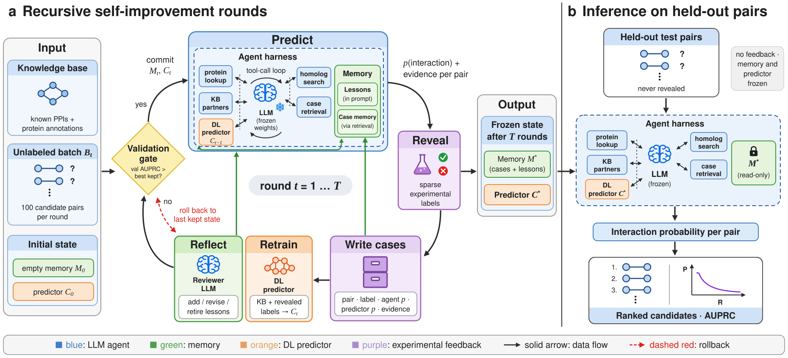

<div align="center">

  <h1 style="margin-top: 10px;">PPI-Agent-RSI</h1>

  <h3>LLM scientific agents for membrane protein–protein interaction discovery, with recursive self-improvement under sparse experimental feedback</h3>

  <div align="center">
    <a href="https://github.com/ENNCELADUS/PPI-Agent-RSI/graphs/commit-activity"></a>
    <a href="https://www.python.org/downloads/"></a>
    <a href="https://docs.astral.sh/uv/"></a>
  </div>

  <p>
    <a href="#why-ppi-agent-rsi">Why?</a>
    ◆ <a href="#quick-start">Quick Start</a>
    ◆ <a href="#installation">Installation</a>
    ◆ <a href="#architecture">Architecture</a>
  </p>

  

</div>

**Figure.** **a**, In each round, the agent (a frozen LLM in a tool-call harness, with memory and a DL
predictor) predicts a batch of unlabeled pairs. Then the labels are revealed and kept as cases. A reviewer
LLM updates the lessons, and the DL predictor is retrained. A validation gate drops the new state only if it is
clearly worse than the best kept state; revealed labels are never dropped. **b**, After the last round, the memory and the predictor are frozen, and the
same harness predicts the held-out pairs.

## Why PPI-Agent-RSI?

Most membrane PPIs are not in public databases, and wet-lab labels arrive slowly and in small batches. This
project asks if an LLM agent can learn from such sparse feedback and if it gains more than a DL predictor
that is retrained on the same labels.

- **🧪 Measure first** – We measure a *fixed*, expert-designed agent before we build any RSI. Failure modes come from evaluation, not from assumptions.
- **🔒 Private test data** – The private test positives have no evidence in any public PPI database, so the LLM cannot know them from memory.
- **🧠 Two-layer memory** – Tested cases (system-written) and lessons (reviewer-written) carry what the agent learns to new pairs.
- **📊 DL comparison** – Each LLM arm runs next to a DL predictor that is retrained on the same revealed labels.
- **🚧 Hidden validation, small budget** – A validation set that the agent never sees gates every round, and each round reveals only a small part of a development set (22T: 1,000 of 10,000 pairs).
- **🚪 Closed-world sandbox** – The agent sees only its sandbox files and has no web tools.

## Quick Start

```bash
# 1. Clone and install (Python ≥ 3.11 via uv; Node for the pi agent runtime)
git clone https://github.com/ENNCELADUS/PPI-Agent-RSI.git
cd PPI-Agent-RSI
uv sync
(cd src/agent/pi && npm ci)

# 2. Configure the LLM endpoint (the shell only; never written to files)
export GATEWAY_API_KEY=...  GATEWAY_API_BASE=...

# 3. Build the PRING classification sandbox and run one batch
uv run python -m src.data.builders.build_pring_sandbox
uv run python -m src.data.builders.build_pring_cls
uv run python -m src.eval.pring_test smoke-run --model gateway/deepseek-pro --limit 1
```

> **Prerequisites**: the PRING data and the private TMP / 22T data in the git-ignored `data/`. The data is not in
> this repository. Run all modules from the repository root as `python -m src.<module>`.

## Installation

```bash
uv sync                          # core dependencies + dev group (pytest, ruff)
uv sync --extra predictor        # src/predictor: torch, numpy
uv sync --extra dgcnn            # src/baselines/dgcnn (SEAL baseline)
(cd src/agent/pi && npm ci)      # the pinned pi agent runtime
```

### LLM endpoint

**Option 1: Model API gateway (default).** Set `GATEWAY_API_KEY` and `GATEWAY_API_BASE`. Both are required;
the adapter has no default endpoint. GPT uses the streaming `/api/v1/response` endpoint;
`gateway/deepseek-pro` and `gateway/kimi` use `/api/v1/start`. pi still manages the tool loop and the Python tools.

**Option 2: DeepSeek V4 Pro endpoint.** Set `LLM_API_KEY` and `LLM_API_BASE`, then use
`--model custom/<model-id> --thinking high`. The provider reuses pi's built-in model settings.

On Windows, `run-agent.ps1` also reads the key from the current user's environment:

```powershell
.\run-agent.ps1 -m src.eval.memory_agent rounds gateway-run --model gateway/deepseek-pro --thinking high
.\run-agent.ps1 -m src.eval.pring_test gateway-test --model gateway/deepseek-pro --limit 1
```

> **Notes**: Credentials are never written to run artifacts. Gateway model limits use local budgets (128k context,
> 16k output). Reported gateway costs are zero placeholders. Use `--workers 8` for eight concurrent batches.
> Remote runs follow the local, untracked `remote-api-agent` skill. The full list of build and run commands is in `CLAUDE.md`.

## Architecture

| Package | Role |
| --- | --- |
| `src/data` | Paths, protein identity, public-database parsers, negative sampling; `builders/` makes every split and sandbox |
| `src/agent` | The agent: tools served over localhost HTTP, one pi session per round, the two memory layers, prompts |
| `src/predictor` | The B0 / V3 motif-graph PPI predictor (inference only) and its ESM-3 feature store |
| `src/baselines` | The DGCNN (SEAL) baseline |
| `src/eval` | Drives the agent: the oracle (sealed labels), discovery rounds, classification tests, reveal rounds, scoring |

Rules: `src/data` never imports `eval` or `baselines`. `src/agent` never imports `eval` and never reads `hidden/`.
The module map is in [`src/README.md`](src/README.md).

| Path | Contents |
| --- | --- |
| `docs/introduction.md` | Motivation and the three research directions |
| `docs/research-status.html` | Research status: task formulation, splits, current design and results |
| `docs/literature.md` | Related work, with links to local PDFs |
| `docs/rsi-architecture.svg` | The figure above |
| `results/` | Readable summaries, one folder per run (raw artifacts in `data/PRING/runs/`) |
| `tests/` | pytest suite, mirrors `src/` |
| `literature/README.md` | Index of the PDFs by topic (the PDFs are git-ignored) |
| `data/`, `docs/research-reports/`, `docs/superpowers/` | Git-ignored: private data, research reports and literature notes, design notes |
